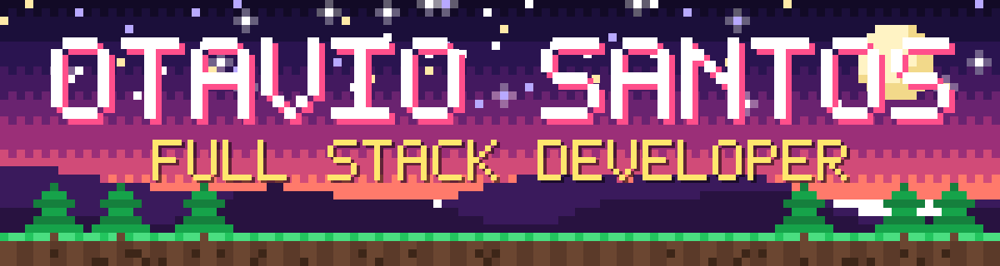

 

**Desenvolvedor Full Stack · React, Node.js, Next.js e TypeScript**

Jaboticabal, SP · remoto ou híbrido

## Sobre

Desenvolvo aplicações web de ponta a ponta e APIs com foco em TypeScript, React, Next.js, Node.js e .NET. Trabalho desde o desenho da arquitetura (Clean Architecture) e a modelagem de bancos relacionais até a entrega em produção, com pipelines de CI/CD e containers Docker. Tenho experiência recente com fluxos de automação inteligente, busca semântica em PostgreSQL com pgvector e integração com LLMs via arquitetura RAG.

Como hobby, estudo computação gráfica na web: desenvolvimento de engines e renderização 3D em tempo real com WebGL, Three.js e shaders GLSL, explorando algoritmos de malhagem, física discreta e concorrência com Web Workers.

**Idiomas:** Português nativo · Inglês profissional

## Entregas e experiência prática

| Contexto | Atuação e resultado |
|---|---|
| Plataforma Ouse Passar (Full Stack) | Definição da arquitetura inicial, desenvolvimento de APIs em .NET e interfaces reativas em React desde os primeiros estágios do produto |
| IA aplicada e busca semântica (Ouse Passar) | Implementação de pipeline RAG com PostgreSQL e pgvector, além de orquestração de agentes de IA para suporte operacional e ferramentas internas |
| Combate à desinformação (Agência Lupa) | Implementação completa da interface inicial da plataforma, com foco em responsividade, acessibilidade e carregamento rápido |
| Automação de orçamentos (DB Cleaning Services) | Desenvolvimento de motor de precificação automatizado para geração rápida de propostas para clientes nos EUA |
| Voxel Engine no navegador (projeto pessoal) | Renderização estável a 60+ FPS, com Greedy Meshing, ruído volumétrico e loop físico executados em Web Workers dedicados |

## Trajetória

- `set/2025 – atual` **Ouse Passar**: Desenvolvedor Full Stack. APIs em .NET, interfaces em React, Clean Architecture, pipelines de CI/CD, busca semântica com PostgreSQL + pgvector e fluxos com IA (RAG).
- `jan/2024 – fev/2025` **Agência Lupa**: Desenvolvedor Front-end. Desenvolvimento integral da interface inicial da plataforma de checagem e combate a fake news.
- `set/2023 – dez/2023` **DB Cleaning Services** (EUA): Desenvolvedor Front-end. Criação de sistema automatizado de orçamentos e evolução da experiência das interfaces web.

## Stack

| Grupo | Ferramentas |
|---|---|
| Linguagens | TypeScript · JavaScript (ESNext) · Python · C# · SQL · HTML5 · CSS3 · GLSL |
| Frontend | React · Next.js · Tailwind CSS · gerenciamento de estado · acessibilidade |
| Backend | Node.js · .NET · APIs RESTful · Clean Architecture |
| Dados e IA | PostgreSQL · pgvector · busca semântica · RAG · integração com LLMs |
| DevOps e ferramental | Docker · CI/CD · Git · GitHub Actions · Linux · Vite |
| Computação gráfica (hobby) | Three.js · WebGL · Web Workers (Transferable Objects) · Greedy Meshing |

## Projetos em destaque

**[world-model-arm](https://github.com/otavio-rb/world-model-arm)**
Estudo comparativo entre SAC e DreamerV3 (world models) no controle de braços robóticos, com foco em eficiência amostral. Projeto de pesquisa e TCC em andamento.

**[voxel-engine.js](https://github.com/otavio-rb/voxel-engine.js)** · [demo online](https://voxel-engine-js.vercel.app/)
Motor voxel 3D para navegador, desenvolvido em TypeScript e Three.js. Inclui Greedy Meshing (redução de mais de 80% da geometria em tela), iluminação volumétrica própria (estilo flood fill) com oclusão de ambiente e geração procedural contínua em Web Workers.

**[dumb-interpreter](https://github.com/otavio-rb/dumb-interpreter)**
Interpretador desenvolvido do zero em JavaScript, para estudo prático de análise léxica, AST e execução.

## Formação

- **Análise e Desenvolvimento de Sistemas**, Faculdade de Tecnologia do Estado de São Paulo (FATEC Ribeirão Preto), 2025–2027
- **Técnico Integrado em Tecnologia da Informação**, Universidade Estadual Paulista (UNESP), 2022–2024
